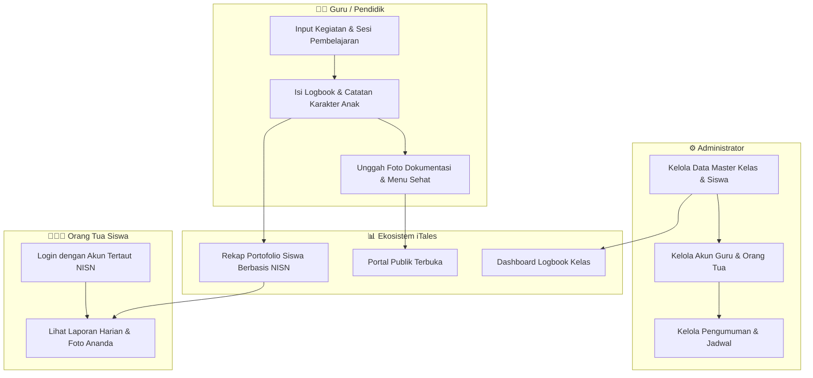
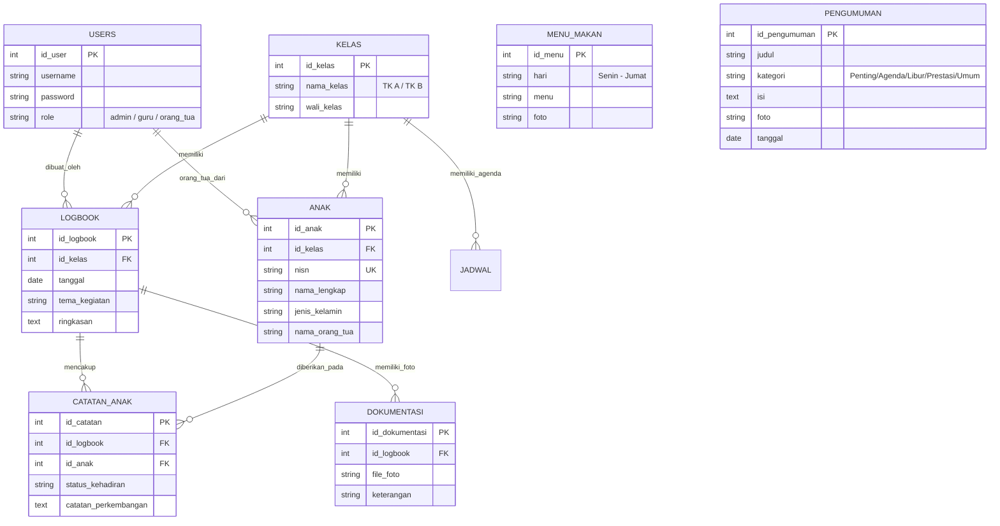

# 📋 DOKUMEN MATERI POSTER & STORYBOARD VIDEO APLIKASI iTales
**Sistem Informasi Digital Terintegrasi – TK SIBER UINSSC**

---

## 🎨 BAGIAN 1: KONTEN LENGKAP POSTER

### 1. Header & Identitas Poster
* **Logo 1 (Kiri)**: Logo Resmi UIN Siber Syekh Nurjati Cirebon (UINSSC)
* **Logo 2 (Kanan)**: Logo Resmi AICIS *(Annual International Conference on Islamic Studies)*
* **Judul Utama Poster**:
  > **iTales: Sistem Informasi Digital Terintegrasi Berbasis Web untuk Transparansi Kegiatan dan Pemantauan Perkembangan Anak Usia Dini pada TK SIBER UINSSC**
* **Tagline**:
  > *"Cerita Kecil, Langkah Besar: Menghubungkan Sekolah dan Keluarga Melalui Ekosistem Digital Terpadu"*
* **Identitas Penulis/Tim**:
  * Nama Pengembang / Mahasiswa: [Nama Anda]
  * Dosen Pembimbing: [Nama Dosen / Pembimbing]
  * Fakultas / Jurusan: [Fakultas / Prodi Anda]
  * Institusi: UIN Siber Syekh Nurjati Cirebon (UINSSC)

---

### 2. Latar Belakang & Permasalahan
* **Latar Belakang**:
  Pendidikan anak usia dini (PAUD/TK) merupakan masa emas (*golden age*) pembentukan karakter dan pembiasaan motorik. Komunikasi dua arah antara guru dan orang tua menjadi pilar mutlak bagi keberhasilan proses belajar.
* **Permasalahan Utama**:
  1. Pencatatan kegiatan harian anak masih dominan manual (buku penghubung fisik), berisiko tercecer atau rusak.
  2. Orang tua yang bekerja sering mengalami kendala keterbatasan waktu untuk memantau aktivitas dan pola gizi harian ananda di sekolah.
  3. Ketiadaan media publikasi digital terbuka yang dapat diakses publik/calon wali murid mengenai agenda kegiatan belajar sekolah secara transparan.
* **Solusi iTales**:
  Platform berbasis web dengan konsep **Dual-Portal Ecosystem**:
  * **Portal Informasi Terbuka**: Menghadirkan jadwal belajar harian, menu nutrisi seimbang, serta pengumuman kegiatan sekolah tanpa sekat login.
  * **Portal Manajemen Berbasis Peran**: Menyediakan lembar kerja logbook guru terstruktur, portofolio perkembangan ananda berbasis NISN, dan sistem kendali akun terpusat.

---

### 3. Matriks Peran Pengguna & Nilai Manfaat (User Role Value)

| Pengguna | Fitur Utama | Nilai Manfaat (Benefit) |
| :--- | :--- | :--- |
| **Publik / Tamu** | • Jadwal Kegiatan Harian • Menu Makanan Sehat Sepekan • Pengumuman & Berita Terkini | Menjamin transparansi kurikulum dan transparansi gizi anak kepada masyarakat luas tanpa perlu login. |
| **Guru / Pendidik** | • Dashboard Ruang Pendidik • Logbook Kelas Harian • Evaluasi Karakter per Siswa • Unggah Dokumentasi Kegiatan | Menghemat waktu administrasi hingga 60%, memudahkan pembuatan portofolio siswa, serta merapikan arsip foto kegiatan. |
| **Orang Tua Siswa** | • Dashboard Portal Orang Tua • Rekap Kehadiran Siswa • Catatan Khusus Guru • Galeri Foto Ananda Pribadi | Privasi terjamin karena portofolio dan dokumentasi foto anak diproteksi khusus sesuai NISN masing-masing anak. |
| **Administrator** | • Kontrol Pengguna Multi-Role • Master Data Kelas & Siswa • Pengaturan Jadwal & Menu • Publikasi Informasi Resmi | Satu pintu kendali tata kelola sekolah, audit keamanan, dan integritas database relasional sekolah. |

---

### 4. Diagram Alur Proses Bisnis (Business Process Flow)

---

### 5. Diagram Database Relasional (Entity Relationship Diagram - ERD)

---

### 6. Showcase Prototype Tampilan Antarmuka (UI Highlights)
Tampilkan 4 tangkapan layar (mockup layar monitor/laptop/tablet) pada poster:
1. **Mockup 1: Landing Page Publik (`/`)**
   * Menonjolkan jadwal kegiatan belajar *realtime* hari ini, pilihan menu makan siang, dan banner pengumuman.
2. **Mockup 2: Panel Administrator (`/dashboard-admin`)**
   * Menonjolkan unified green sidebar `#18302b` dengan 8 navigasi lengkap, rekap akun, dan sistem kendali satu pintu.
3. **Mockup 3: Lembar Evaluasi Logbook Guru (`/detail-logbook`)**
   * Menonjolkan form penilaian capaian karakter harian anak, absensi, serta galeri upload foto dokumentasi.
4. **Mockup 4: Portal Pemantauan Orang Tua (`/dashboard-ortu`)**
   * Menonjolkan kemudahan orang tua melihat riwayat foto kegiatan anak dan rekap evaluasi secara personal.

---

### 7. Landasan Teknologi & Keamanan
* **Arsitektur**: Client-Server berbasis Web (Responsive Mobile-First).
* **Frontend**: HTML5 Semantik, CSS3 Native Design System, JavaScript Vanilla ES6 (Bebas ketergantungan library berat, waktu muat < 1 detik).
* **Backend**: Node.js, Express.js.
* **Database**: MySQL Engine dengan Foreign Key Integrity.
* **Keamanan**: Bcrypt 10-Salt Password Encryption, Express-Session, Anti Brute-Force Rate Limiting, Validasi Whitelist Role Middleware.

---

## 🎥 BAGIAN 2: NASKAH & STORYBOARD VIDEO PRODUK (90 DETIK)

### Informasi Produksi Video
* **Rasio Resolusi**: 16:9 (Landscape 1920x1080 Full HD) atau 9:16 (Reels/TikTok/Shorts).
* **Penempatan Logo**: 
  * Pojok Kiri Atas: **Logo UIN Siber Syekh Nurjati Cirebon (UINSSC)**
  * Pojok Kanan Atas: **Logo AICIS**
* **Gaya Musik Latar (BGM)**: Upbeat, Inspiratif, Ramah Anak, dan Elegan (Volume 20-30%).

---

### Tabel Naskah & Panduan Visual

| Waktu | Visualisasi Adegan | Grafis / Teks di Layar | Narasi Suara (Voiceover) |
| :---: | :--- | :--- | :--- |
| **00:00 - 00:10** *(10 dtk)* | Transisi pembuka modern. Menampilkan ilustrasi suasana anak-anak belajar dan bermain dengan ceria di sekolah. | • **Logo UINSSC** & **Logo AICIS** • Teks: *"iTales: Smart Early Childhood Learning Log"* | *"Masa kanak-kanak adalah masa berharga di mana setiap cerita kecil menjadi fondasi langkah besar mereka. Namun, sudahkah sekolah dan orang tua saling terhubung secara transparan dan mudah?"* |
| **00:10 - 00:25** *(15 dtk)* | Cuplikan layar responsif dari Landing Page iTales. Kursor menggulir ke bawah: melihat jadwal harian dan menu makan bergizi. | • Teks: *"Portal Informasi Terbuka Tanpa Sekat Login"* • Fitur: Jadwal Hari Ini & Menu Makan Sehat | *"Memperkenalkan iTales — Inovasi platform digital dari TK SIBER UIN Siber Syekh Nurjati Cirebon. Menyajikan agenda belajar harian dan nutrisi makanan sehat ananda yang dapat diakses publik secara realtime."* |
| **00:25 - 00:45** *(20 dtk)* | Layar masuk ke antarmuka Guru (`/dashboard-guru`). Memperlihatkan guru memilih kelas, mengisi logbook, dan mengunggah dokumentasi foto belajar. | • Teks: *"Administrasi Cepat, Portofolio Terdokumentasi"* • Fitur: Logbook Harian & Galeri Foto Kelas | *"Bagi para pendidik, iTales mengubah tumpukan administrasi kertas menjadi logbook digital praktis: mencatat kehadiran, evaluasi karakter, serta mendokumentasikan kegiatan anak secara rapi dan terarsip aman."* |
| **00:45 - 01:05** *(20 dtk)* | Layar memperlihatkan ponsel pintar dengan tampilan Portal Orang Tua (`/dashboard-ortu`). Membuka foto dan catatan khusus guru. | • Teks: *"Pemantauan Eksklusif Berbasis NISN"* • Fitur: Portofolio Personal & Rekap Perkembangan | *"Bagi orang tua, rasa khawatir berganti ketenangan. Lewat login berbasis NISN yang terproteksi, orang tua dapat memantau kehadiran, catatan khusus, dan kebahagiaan ananda langsung dari genggaman."* |
| **01:05 - 01:20** *(15 dtk)* | Tampilan Dashboard Admin (`/dashboard-admin`), memperlihatkan navigasi terpadu, skema database, dan kendali akun. | • Teks: *"Arsitektur Andal & Terenkripsi"* • Fitur: Role-Based Access & Data Integrity | *"Ditenagai arsitektur database relasional yang kokoh, enkripsi password, serta desain sistem yang seragam, iTales menjaga privasi sekolah dan siswa dengan standar keamanan tinggi."* |
| **01:20 - 01:30** *(10 dtk)* | Animasi penutup: Logo iTales, Logo UINSSC, Logo AICIS, tautan website, dan alamat sekolah. | • Teks: *"iTales – TK SIBER UINSSC"* • Tagline: *"Cerita Kecil, Langkah Besar"* | *"Bersama iTales, mari wujudkan ekosistem pendidikan anak usia dini yang transparan, modern, dan penuh cinta. iTales — Cerita Kecil, Langkah Besar!"* |

---

## 💡 TIPS PENYUSUNAN DESAIN (CANVA / FIGMA / COREL)
1. **Palet Warna Dominan**:
   * Hijau Tua Islami / Akademik: `#18302b`
   * Hijau Forest / Brand: `#124b3c`
   * Hijau Aksen Lembut: `#d6ead2`
   * Background Bersih: `#f4f6f5` & `#ffffff`
2. **Tipografi Font**:
   * Gunakan font **Inter**, **Montserrat**, atau **Plus Jakarta Sans** agar modern dan mudah dibaca dari jarak 1-2 meter.
3. **Pencetakan Poster**:
   * Gunakan ukuran standar **A1** (59.4 x 84.1 cm) atau **X-Banner** (60 x 160 cm) dengan resolusi minimal 300 DPI (CMYK).

